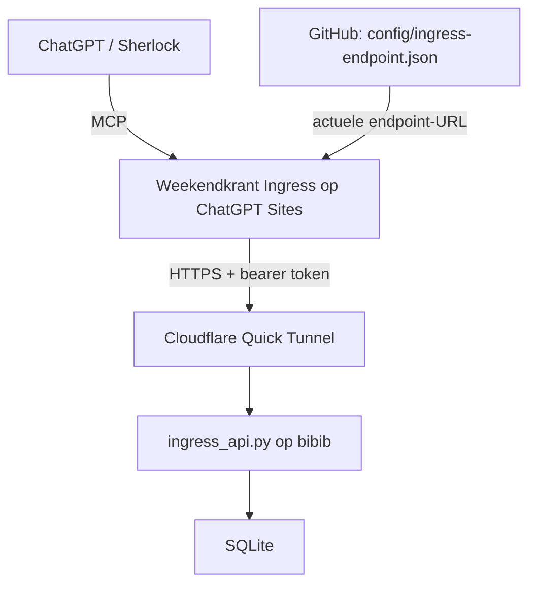

# Weekendkrant Ingress: bronbeheer en deployment

Dit document is het canonieke contract voor bronbeheer, deployment en de
architecturale motivatie van de ChatGPT Site/MCP-plugin **Weekendkrant Ingress**.
Het beschrijft de werkwijze; het voert geen synchronisatie of publicatie uit.

## Eén bron voor ontwikkeling

Alle niet-geheime broncode van Weekendkrant wordt uitsluitend onderhouden in
`willemg/weekendkrant`. De canonieke pluginbron staat in
`plugin/weekendkrant_ingress/`.

ChatGPT Sites is geen ontwikkelrepository en geen alternatieve source of truth.
De interne bronopslag en versionering van Sites zijn uitsluitend onderdeel van
de deployment/runtimeomgeving. De Sites-bron is een projectie van één gekozen
GitHub-commit. Fixes of functionele wijzigingen mogen nooit rechtstreeks in
Sites ontwikkeld worden.

## Waarom de Sites-adapter nodig blijft



Bibib gebruikt bewust geen eigen publiek domein. De Cloudflare Quick Tunnel
levert een tijdelijke willekeurige hostname onder `*.trycloudflare.com`, die na
herstart kan veranderen. Daarom staat de actuele URL, met pad `/ingress`, in
`config/ingress-endpoint.json`. De Site/MCP-adapter leest deze discoverypointer
bij calls en leidt de backendpaden af op dezelfde gevalideerde host.

De Site biedt ChatGPT een stabiele MCP/pluginlaag terwijl de achterliggende
bibib-URL dynamisch mag blijven. GitHub verzorgt hier discovery en bronbeheer;
de requestdata gaat via de tunnel naar de API en SQLite.

De overwogen variant `ChatGPT -> rechtstreeks MCP op bibib` zou voor een
blijvende pluginregistratie een stabiele publiek bereikbare MCP-URL vereisen.
De huidige Quick Tunnel levert die stabiliteit niet. Een stabielere
Cloudflare-opstelling voor dit project zou extra DNS-/domeinbeheer vereisen.
Weekendkrant kiest expliciet om geen eigen domeinnaam of extra DNS-infrastructuur
te introduceren enkel voor deze plugin. De kleine Sites-adapter blijft daarom
voorlopig nuttig: dit is een bewuste trade-off.

## Twee afzonderlijke deploymentstappen

### Stap 1 — synchroniseren

Kies één concrete commit-SHA op `main` van `willemg/weekendkrant` waarvan de
pluginwijzigingen gereviewd, getest en gemerged zijn. Neem uitsluitend de bron
uit `plugin/weekendkrant_ingress/` van die commit en synchroniseer deze
ongewijzigd naar het bestaande ChatGPT Sites-project **Weekendkrant Ingress**.
Gebruik tijdens de synchronisatie die vaste commit, ook als `main` intussen
verder beweegt.

Tijdens synchronisatie wordt geen code geschreven, gerefactord of gefixt.
Handmatige afwijkingen en secretwijzigingen zijn niet toegestaan. De Sites-bron
moet een exacte projectie van de gekozen GitHub-bron zijn; Sites-versiegegevens
vervangen de GitHub commit-SHA niet.

### Stap 2 — publiceren

Publiceer vervolgens de gesynchroniseerde Site-versie. Pas publicatie maakt de
nieuwe MCP-toolversie actief voor ChatGPT. Synchroniseren verandert de bron in
de deploymentomgeving; publiceren activeert die versie. Het zijn twee
verschillende handelingen:

1. GitHub `main`, op één vastgelegde commit → synchronisatie → Sites-bron.
2. Die Sites-bron → publicatie → actieve Weekendkrant Ingress-plugin.

Voor dit project is momenteel geen directe GitHub→Sites deploymentintegratie
geconfigureerd/beschikbaar die `willemg/weekendkrant/plugin/weekendkrant_ingress/`
uit een gekozen commit rechtstreeks als deploymentbron gebruikt. Daarom bestaat
de expliciete synchronisatiestap. Dit beschrijft de projectinrichting, geen
algemene of blijvende beperking van het product.

Als ChatGPT Sites later een ondersteunde repo-backed deployment biedt waarbij
een specifieke GitHub-directory en commit rechtstreeks als deploymentbron
kunnen dienen, mag deze tweestapsflow worden vereenvoudigd. GitHub moet ook dan
de enige source of truth blijven.

Een Git-submodule lost dit op zichzelf niet op. De relevante eis is dat Sites
een specifieke GitHub-bron als build/deploymentsource ondersteunt, niet alleen
dat Sites Git-data kan zien. Zonder zo'n ondersteunde integratie vereist een
submodule nog steeds synchronisatie/versionering aan Sites-zijde en introduceert
zij bovendien een tweede Git-pointer. Deze werkwijze gebruikt geen submodule.

## Tests bij de bron; verificatie bij deployment

Functionele tests en de build horen bij de bron en draaien vóór merge vanuit de
GitHub-checkout:

```sh
npm --prefix plugin/weekendkrant_ingress test
npm --prefix plugin/weekendkrant_ingress run build
```

Na merge wordt de reeds geteste bron gedeployed. Sites is geen tweede
ontwikkelomgeving en er volgt daar geen tweede functionele testcyclus.
Deploymentverificatie mag uitsluitend controleren dat de juiste GitHub-commit
is gesynchroniseerd, de Site succesvol kan worden gepubliceerd en na publicatie
de verwachte toolversie daadwerkelijk bereikbaar is. Die laatste controle is
smoke verification van de deployment.

Als tijdens synchronisatie, publicatie of smoke verification een codeprobleem
blijkt, geldt steeds dezelfde route:

1. Stop de deployment; pas geen code aan in Sites.
2. Maak de wijziging in `willemg/weekendkrant` op een nieuwe branch.
3. Draai de functionele tests en build vanuit die checkout.
4. Laat de nieuwe GitHub-PR reviewen.
5. Merge de PR.
6. Deploy opnieuw vanaf de nieuwe concrete commit op `main`.

## Deploymentidentiteit

Iedere deployment moet herleidbaar zijn tot één concrete GitHub commit-SHA.
Het deploymentrapport vermeldt minimaal:

| Veld | Vast te leggen informatie |
| --- | --- |
| GitHub commit-SHA | Volledige SHA van de gekozen commit op `main`. |
| Sites-project | `Weekendkrant Ingress`. |
| Synchronisatie | Geslaagd of niet geslaagd voor die exacte bron. |
| Publicatie | Geslaagd of niet geslaagd voor de gesynchroniseerde versie. |
| Post-publish smoke verification | Eventuele controle, resultaat of expliciet niet uitgevoerd. |

Een geslaagde synchronisatie bewijst niet dat de versie actief is: het rapport
moet ook het publicatieresultaat bevatten. Leg waar beschikbaar de bijbehorende
Sites-versie/publicatie-identificatie vast om het verband te kunnen controleren.
Zo kan uit het laatste bevestigde publicatierapport worden afgeleid welke
GitHub-versie in productie draait. Dit is een rapportagecontract; er wordt geen
deploymentdatabase of automatische state geïntroduceerd.

## Runtimezaken buiten Git

`WEEKENDKRANT_INGRESS_TOKEN` blijft een runtime-secret. De repository bevat alleen
de secretnaam, nooit de echte waarde. De waarde wordt niet vanuit GitHub als
gewone broncode naar Sites gekopieerd en blijft buiten Git in de runtimeconfiguratie
van bibib en de secretopslag van Sites.

Deployment van broncode mag de bestaande secretconfiguratie niet overschrijven.
Sites beheert ook operationele versie-/deploymentrecords, pluginregistratie en
toegangsinstellingen. Operationele SQLite-data op bibib blijft buiten Git.
Niet-geheime bronrepresentaties, zoals het hostingmanifest met project-ID en
MCP-capability, horen wel bij de canonieke pluginbron.
